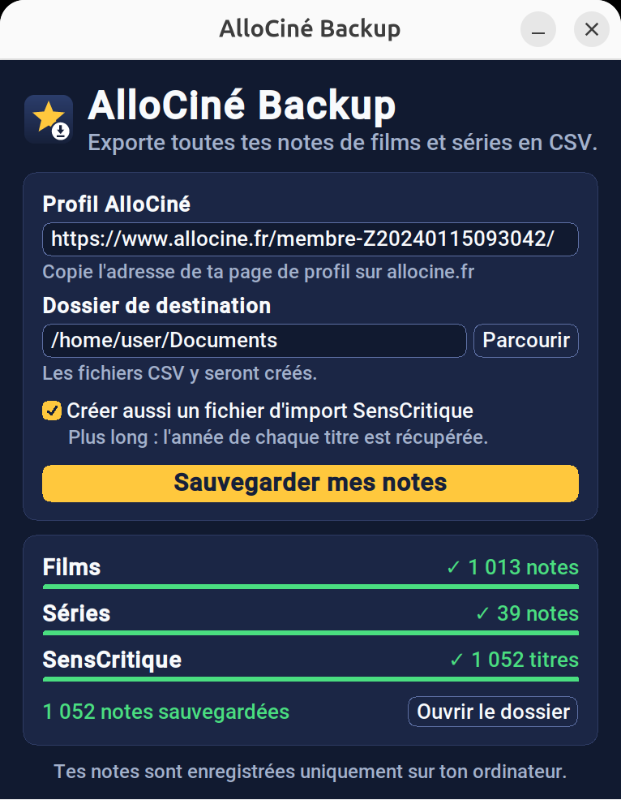

<div align="center">


# AlloCiné Backup

**Exporte toutes tes notes de films et séries AlloCiné en CSV, et importe-les sur SensCritique.**

[](https://github.com/CLeBeRFR/AlloCine-Backup-Account-Creator/actions/workflows/ci.yml)
[](https://github.com/CLeBeRFR/AlloCine-Backup-Account-Creator/releases/latest)


[](LICENSE)

[**Télécharger**](https://github.com/CLeBeRFR/AlloCine-Backup-Account-Creator/releases/latest) · [Utilisation](#utilisation) · [SensCritique](#importer-ses-notes-sur-senscritique) · [Format des fichiers](#format-des-fichiers) · [Développement](#développement)



</div>

## Pourquoi ?

AlloCiné ne propose aucun moyen d'exporter les notes que l'on a attribuées. Si un jour le site perd ses données, ferme ou supprime ton compte, des années de notes disparaissent. AlloCiné Backup les récupère depuis ton profil public et les enregistre dans des fichiers CSV que tu gardes chez toi.

- **Simple** : colle l'adresse de ton profil, clique, c'est fini.
- **Complet** : films et séries, toutes les pages du profil.
- **Ouvert** : des fichiers CSV lisibles par Excel, LibreOffice, Google Sheets ou n'importe quel script.
- **Compatible SensCritique** : en option, un fichier prêt à importer pour retrouver toutes tes notes sur [SensCritique](https://www.senscritique.com).
- **Local** : aucun compte, aucun serveur intermédiaire, les fichiers restent sur ton ordinateur.

## Installation

Télécharge la dernière version depuis la page des [releases](https://github.com/CLeBeRFR/AlloCine-Backup-Account-Creator/releases/latest), rien d'autre n'est à installer.

| Système | Fichier | Lancement |
| --- | --- | --- |
| Windows 10 et 11 | `AlloCine-Backup-windows.exe` | Double-clic. L'exécutable n'étant pas signé, Windows SmartScreen peut afficher un avertissement : *Informations complémentaires*, puis *Exécuter quand même*. |
| Linux (x86-64) | `AlloCine-Backup-linux.tar.gz` | `tar -xzf AlloCine-Backup-linux.tar.gz` puis `./AlloCine-Backup` |

## Utilisation

1. Ouvre ton profil sur [allocine.fr](https://www.allocine.fr) et copie l'adresse de la page, du type `https://www.allocine.fr/membre-Z2012…/`.
2. Colle-la dans l'application et choisis le dossier de destination.
3. Coche **Créer aussi un fichier d'import SensCritique** si tu veux migrer tes notes (voir [plus bas](#importer-ses-notes-sur-senscritique)).
4. Clique sur **Sauvegarder mes notes**. La progression s'affiche étape par étape, puis **Ouvrir le dossier** donne accès aux fichiers.

### En ligne de commande

Depuis les sources (voir [Développement](#développement)) :

```bash
python -m allocine_backup https://www.allocine.fr/membre-XXXX/ -d ~/Documents
```

Ajoute `--senscritique` pour créer aussi le fichier d'import SensCritique.

```
Démarrage de la récupération des notes pour le type de média films
Nombre de pages : 29
Extraction des pages, le processus peut être long...
Fin de la récupération des notes, 1013 films sauvegardés
Démarrage de la récupération des notes pour le type de média series
Nombre de pages : 2
Extraction des pages, le processus peut être long...
Fin de la récupération des notes, 39 series sauvegardés
Fichiers sauvegardés :
  /home/user/Documents/liste_notes_films.csv
  /home/user/Documents/liste_notes_series.csv
```

## Importer ses notes sur SensCritique

SensCritique accepte depuis 2025 l'[import d'une collection au format CSV](https://www.senscritique.com/l-edito/post/comment_importer_ses_notes_sur_senscritique). Avec l'option SensCritique, AlloCiné Backup crée en plus le fichier `import_senscritique.csv`, qui regroupe films et séries.

1. Lance une sauvegarde avec la case **Créer aussi un fichier d'import SensCritique** cochée.
2. Sur SensCritique, ouvre [Paramètres › Compte](https://www.senscritique.com/parametres/compte) : la section d'import de collection est tout en bas.
3. Envoie `import_senscritique.csv`. SensCritique confirme le résultat de l'import par e-mail.

Réimporter le même fichier ne crée pas de doublon : SensCritique n'ajoute que les données manquantes.

Comment les notes sont converties :

| AlloCiné | SensCritique |
| --- | --- |
| Note de 0,5 à 5 étoiles | Note de 1 à 10 (×2, donc 3,5 étoiles donnent 7/10) |
| Film ou série | `movie` ou `tvshow` |
| Titre français | Titre identique |
| Année (absente du profil) | Lue sur la fiche AlloCiné du titre : année de production d'un film, première année de diffusion d'une série. Laissée vide si AlloCiné ne l'indique pas. |
| Titre noté | Marqué comme vu, ni envie ni recommandé |

> [!NOTE]
> L'année de sortie n'apparaît pas sur le profil : l'application ouvre donc la fiche de chaque titre, une requête toutes les 0,5 seconde pour ne pas être bloquée par AlloCiné. Compte environ 9 minutes pour 1 000 titres. Les sauvegardes `liste_notes_*.csv` sont écrites avant cette étape et restent disponibles même si elle est interrompue.

## Format des fichiers

Deux fichiers sont créés, `liste_notes_films.csv` et `liste_notes_series.csv`, au format attendu par un tableur réglé en français : séparateur `;`, note avec une virgule décimale, encodage UTF-8 reconnu par Excel.

```csv
Nom;Note
Limitless;4,0
Le Bureau des Légendes;5,0
John Wick : Chapitre 4;2,0
```

`import_senscritique.csv` suit le format SensCritique : séparateur `,`, encodage UTF-8, une ligne par titre.

```csv
universe,title,release_date,rating,is_wishlisted,is_recommended,is_done
movie,Limitless,2011,8,false,false,true
tvshow,Le Bureau des Légendes,2015,10,false,false,true
movie,John Wick : Chapitre 4,2023,4,false,false,true
```

Une nouvelle sauvegarde remplace les fichiers existants du dossier choisi.

## Développement

Python 3.10 ou plus récent est nécessaire. Sous Linux, l'interface graphique demande aussi Tkinter (`sudo apt install python3-tk` sur Debian et Ubuntu).

```bash
git clone https://github.com/CLeBeRFR/AlloCine-Backup-Account-Creator.git
cd AlloCine-Backup-Account-Creator
python -m venv .venv && source .venv/bin/activate
pip install -e .
```

| Commande | Rôle |
| --- | --- |
| `python -m allocine_backup.gui` | Lance l'interface graphique |
| `python -m allocine_backup <url>` | Lance la ligne de commande |
| `python -m unittest discover -s tests -t .` | Exécute les tests (hors ligne) |
| `python tools/generate_logo.py` | Régénère le logo et l'icône |

```
allocine_backup/
├── scraper.py   # récupération des pages AlloCiné, écriture des CSV
│                #   (sauvegarde et import SensCritique)
├── cli.py       # ligne de commande
├── gui.py       # interface graphique (CustomTkinter)
└── assets/      # logo et icône, générés par tools/generate_logo.py
tests/           # tests unitaires, sans accès réseau
```

### Publier une version

1. Mettre à jour `__version__` dans `allocine_backup/__init__.py`.
2. Créer et pousser le tag correspondant :

```bash
git tag v1.0.0
git push origin v1.0.0
```

GitHub Actions lance les tests, construit les exécutables Windows et Linux, vérifie qu'ils démarrent, puis publie la release.

## Licence

Distribué sous licence [GPL-3.0](LICENSE).

Projet personnel, affilié ni à AlloCiné ni à SensCritique. Il lit uniquement des pages publiques d'AlloCiné : ton profil et, pour l'option SensCritique, la fiche de chaque titre noté.
